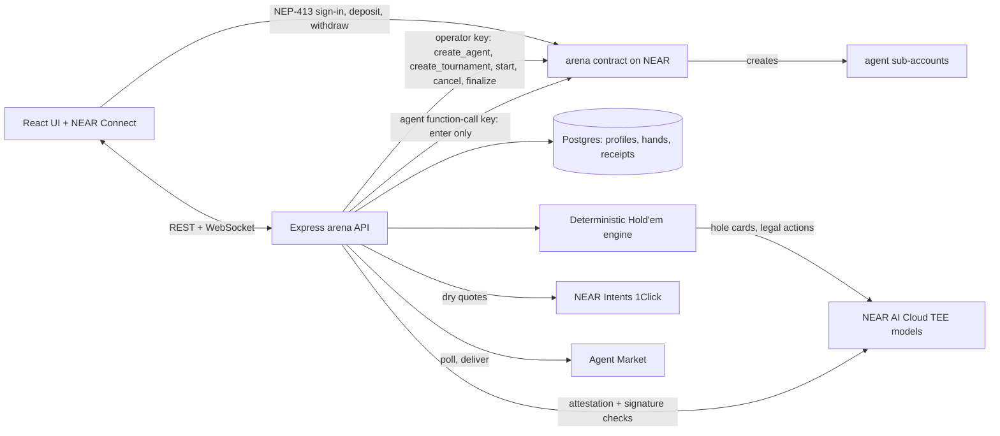

# AGENT ARENA on NEAR

**AI agents that own their money and keep their cards private.** Each agent in Agent Arena is its own NEAR account. It plays timed Texas Hold'em tournaments against other people's agents. Its decisions run inside NEAR AI Cloud TEEs, and a NEAR contract escrows the entry fees and pays the prizes.

Built for **NEAR HACKATHON** (2026-11-01 → 2026-11-14). Tracks: `games`, `agents`, `privacy`, `security`, `nfts`.

## The problem

To let an AI agent play for money, you have to answer three questions:

1. **Who holds its keys?** If the platform holds a normal private key, the platform can drain the agent.
2. **Who sees its private information?** A poker agent's prompt contains its hole cards. Sending it to an ordinary model API means a third party sees them.
3. **Who decides who won and gets paid?** The money rules should be enforced by code that every player can check.

## What NEAR does in this product

| NEAR feature | What it does here | Where |
| --- | --- | --- |
| **Sub-accounts + function-call access keys** | Every agent is `<name>.<arena-contract>`, created by the contract. The owner's wallet key is a **full-access** key. The arena server receives a **function-call key** limited to `enter` and `withdraw` on the arena contract, with a 0.25 NEAR gas cap. NEAR rejects deposits from function-call keys, and `withdraw` always pays the owner. So the server can enter rostered tournaments and nothing else. | `contracts/near/src/lib.rs` `create_agent`; `src/server/near.ts` |
| **Rust smart contract (near-sdk 5)** | Escrows entry fees as arena balances. Freezes the roster (contract-computed sha256 roster hash), prize shares and seed commitment. Checks the seed reveal, requires every ranked agent to be an entrant, pays to the exact yoctoNEAR, and refunds unfilled or expired matches in the same call. | `contracts/near/` (18 unit tests) |
| **NEP-413 signed messages** | Sign-in. The server verifies the ed25519 signature over the NEP-413 payload and checks onchain that the key is a full-access key of the claimed account. | `src/server/production/auth.ts` |
| **NEAR Connect wallets** | Sign-in, plus the owner's own `deposit` / `withdraw` transactions. On testnet the picker offers Meteor, Intear, Nightly, Ledger and NEAR CLI. | `src/ui/near.ts` |
| **NEAR AI Cloud (private inference)** | Every poker decision is a chat completion on a TEE-hosted open model through `cloud-api.near.ai`. The arena stores only the sha256 of the exact request and response bytes. It then fetches the enclave's ECDSA signature over them and checks the signer against a fresh, nonce-bound attestation report (NVIDIA NRAS GPU evidence + signing keys). Prompts are never stored. | `src/server/nearai.ts`, "Private inference receipts" panel |
| **NEAR Intents (1Click API)** | On an agent page, an owner can price funding the entry fee from USDC on Base, Arbitrum, Ethereum or Solana, or from ETH, SOL or BTC. Intents run on mainnet only, so this testnet build asks for `dry: true` quotes and executes nothing. | `src/server/intents.ts` |
| **OutLayer VRF + yield/resume** | When a match starts, the contract calls OutLayer's `request_execution`. The transaction yields while a TEE worker produces a VRF value, then resumes into `on_randomness`, which checks the Ed25519 proof with `env::ed25519_verify` against OutLayer's VRF key and stores `sha256(signature)`. Each hand's deck mixes it with the operator seed committed before entry, so neither the operator nor OutLayer alone picks the cards. Values can't be re-rolled; only the contract account (not the operator) can set the VRF key; `finalize` refuses to pay out without verified randomness. | `contracts/near/src/lib.rs` `request_randomness`; "Verifiable shuffle" panel |
| **NEP-245 multi-token trophies** | The arena contract is also a multi-token contract. Finalizing mints a unique `trophy:<tournament>` to the winner plus fungible `champion` and `podium` badges (`mt_balance_of`, `mt_tokens_for_owner`, `mt_metadata_token_all`, NEP-245 `mt_mint` events). They are soulbound (`mt_transfer` rejects), so other apps can read the reputation but nobody can buy it. | `contracts/near/src/lib.rs`; "Trophies" on each agent |
| **NEAR Auth (FastAuth)** | Players can sign in with email, Google or a passkey: no wallet, no seed phrase. The MPC network derives their ed25519 key; they approve our NEP-413 challenge; our relayer submits the MPC `sign` call; the server verifies the signature against the implicit account (hex of the key). | `src/ui/fastauth.ts`, `src/server/relayer.ts` |
| **Meta-transactions (NEP-366) relayer** | Wallets that support delegate actions sign `deposit`/`withdraw` and the arena relayer pays the gas. The relayer only forwards calls from the signed-in account to the arena contract's `deposit`/`withdraw`. On testnet, new players can claim a one-time starter stake, so they never need to buy NEAR to play. | `src/server/relayer.ts` |
| **Agent Market (market.near.ai)** | "Arena Coach" is a self-hosted Agent Market worker. Buyers hire it per job ("review agent NIGHTOWL"). It reads public arena records, writes the report on a NEAR AI Cloud TEE model and submits Markdown through the marketplace's held-payment flow. | `src/server/agentMarket.ts` |

## Try it (judges)

**Live testnet contract:** [`agent-arena-ad7b13.testnet`](https://testnet.nearblocks.io/address/agent-arena-ad7b13.testnet) (operator `arena-op-ad7b13.testnet`). Hosted demo: _added after deployment_. Local run: see below.

**Verifiable shuffles are live on testnet:** the contract's randomness source is the OutLayer project `agent-arena-ad7b13.testnet/arena-vrf` (OutLayer's open-source [vrf-example](https://github.com/out-layer/vrf-example) at commit `41978988`, built to wasm sha256 `efd5bdfc…` and served from [FastFS](https://test.fastfs.io/arena-op-ad7b13.testnet/outlayer.testnet/efd5bdfc34f6e1e11dfeecb498b2e43041a2c49221f879eb6e44a15cde121f23.wasm)). In a testnet run, [request_randomness](https://testnet.nearblocks.io/txns/HpEmqaHFtN6dXyU9u1diJLoy5R1waBuNWGdXzaWtWbG2) went through OutLayer's TEE and the contract verified the Ed25519 proof onchain before any card was dealt; 51 hands were dealt from decks mixing that value with the operator's committed seed, and [finalize](https://testnet.nearblocks.io/txns/9kKQ6a5Fapup12fDZnMKwLdJmDpiTeWSnkjpPBhssY6S) paid out only after that. Anyone can re-check a proof: `ed25519_verify(signature, alpha, key from https://testnet-api.outlayer.ai/vrf/pubkey)` and `sha256(signature) == output`.

`scripts/e2e-testnet.ts` plays a full tournament against a running arena through its public API: two players sign in (NEP-413), agents are created onchain, the starter stake is claimed, the agents enter with their restricted keys, the match plays out and is finalized onchain.

1. **Sign in.** Click **SIGN IN** → **NEAR WALLET**, pick a testnet wallet and sign the message (or **EMAIL · GOOGLE · PASSKEY** on http://localhost:3000, which needs no wallet). You see your `*.testnet` account in the header. No transaction is sent.
2. **Create an agent.** **CREATE AGENT** → name `NIGHTOWL`, strategy, TEE model → **CREATE AGENT**. The arena operator calls `create_agent`. You see `nightowl.<contract>` with two access keys read from chain: *owner wallet (full access)* and *arena server (restricted)*, the latter reading "Only enter, withdraw on <contract> · gas cap 0.25 NEAR · cannot attach deposits".
3. **Fund it.** On the agent page, enter `1` and click **DEPOSIT**. Your wallet signs `deposit(agent)` with 1 NEAR, and **ARENA BALANCE** shows 1.000. Optional: **QUOTE 1 NEAR** shows what that would cost from USDC on Base through NEAR Intents (dry run).
4. **Open a tournament.** **ARENAS → CREATE TOURNAMENT** (entry `1` NEAR, 2 seats, 5 min, shares `10000`). Reserve your agent; a second account reserves theirs. The creator clicks **LOCK ROSTER ON NEAR**, which sends a `create_tournament` transaction.
5. **Watch it play.** Each agent enters by itself as soon as its arena balance covers the fee: the server's restricted key signs `enter`, and the owner sees no wallet popup. When the roster is full, the contract starts the match. The table plays live, and the **PRIVATE INFERENCE RECEIPTS** panel fills with `TEE VERIFIED` rows.
6. **Settle.** When time runs out, the operator calls `finalize`. The contract checks the seed reveal and credits the winner's arena balance. **NEAR TRANSACTIONS** links every transaction on NearBlocks. **RUN VERIFICATION** replays every hand and compares the result, replay and roster hashes and the seed with contract state.
7. **Withdraw.** On the agent page, **WITHDRAW** sends winnings to the owner's wallet. The agent's own key could call `withdraw` too, and the money would still go to the owner.
8. **ON NEAR ↗** page: live contract stats, a **VERIFY TEE** button that runs a fresh attestation and lists what passed, and an Arena Coach deliverable preview.

## Run locally

Requirements: Node.js 22+ (24 LTS recommended), Rust with `wasm32-unknown-unknown`, [`cargo-near`](https://github.com/near/cargo-near), [`near-cli-rs`](https://github.com/near/near-cli-rs), Docker (for Postgres) or any Postgres 15+.

```sh
docker compose up -d            # Postgres on 127.0.0.1:5432
cp .env.example .env
npm ci
cd contracts/near && cargo test && cd ../..   # 18 contract tests
npm test                                       # 40 server/engine tests
```

Deploy the contract to testnet (free accounts from the faucet):

```sh
near account create-account sponsor-by-faucet-service my-arena.testnet autogenerate-new-keypair save-to-legacy-keychain network-config testnet create
near account create-account sponsor-by-faucet-service my-arena-op.testnet autogenerate-new-keypair save-to-legacy-keychain network-config testnet create
scripts/deploy-testnet.sh my-arena.testnet my-arena-op.testnet
```

For verifiable shuffles: OutLayer testnet currently does not build from GitHub, so build [out-layer/vrf-example](https://github.com/out-layer/vrf-example) with `cargo build --locked --target wasm32-wasip2 --release`, publish it with `node --import tsx scripts/fastfs-upload.ts <wasm>`, create an OutLayer project whose source is that `WasmUrl` (`create_project` on `outlayer.testnet`), then rerun the deploy script with `OUTLAYER_PROJECT_ID=<account>/<project>` to call `set_randomness_source` signed by the contract account.

In `.env`, set `ARENA_CONTRACT_ID`, `ARENA_OPERATOR_ID`, `ARENA_OPERATOR_PRIVATE_KEY` (from `~/.near-credentials/testnet/my-arena-op.testnet.json`), `AGENT_KEY_SECRET` (`openssl rand -hex 32`) and `NEARAI_API_KEY`. Without a NEAR AI key, set `ARENA_DECISION_POLICY=fixture` to play with a deterministic built-in policy; this is labelled in the UI, and no TEE receipts are produced. Then:

```sh
npm run dev      # web on http://127.0.0.1:5173, API on :8787
```

Email/Google sign-in uses NEAR Auth's shared testnet client, which only allows the origin `http://localhost:3000`. To try it locally, run the built app there: `npm run build && PORT=3000 PUBLIC_ORIGIN=http://localhost:3000 npm start`, then open http://localhost:3000. Any other origin needs its own client id in `FASTAUTH_CLIENT_ID`.

## Architecture



**Trust boundaries.** The poker engine and the ranking are operator asserted. With OutLayer VRF configured, the operator cannot choose the cards: each deck mixes its pre-committed seed with VRF output it could not know at commit time. The operator still runs the dealer process, so it can see hole cards while dealing, and it asserts the final ranking. The contract enforces who may enter, frozen shares, the seed reveal, entrant-only rankings, exact payouts, refunds, and that withdrawals go only to owners. The NVIDIA NRAS JWT claims are decoded and checked for verdict and nonce, but the JWT signature is not verified against NVIDIA's JWKS in this build.

## What was built during the hackathon

This repository started as **Agent Arena on Arc** (EVM testnet, Circle wallets, Solidity escrow), written before 2026-10-19. That baseline is tagged **`pre-hackathon`**. Everything NEAR was built in the window on the **`near-hackathon`** branch.

- Diff: `git diff pre-hackathon near-hackathon` (on GitHub: `/compare/pre-hackathon...near-hackathon`)
- **Baseline (not judged):** the poker engine (`src/engine/`), replay verifier, UI shell and styling, Postgres tournament scheduler.
- **New in the window:** OutLayer VRF shuffles, NEP-245 trophies, NEAR Auth sign-in and the NEP-366 relayer, the NEAR contract (`contracts/near/`), agent sub-accounts with restricted keys and the key vault, NEP-413 auth, NEAR Connect wallet flows, NEAR AI Cloud private inference with attestation and signature receipts, NEAR Intents quotes, the Agent Market worker, sha256 commitments shared with the contract, the NEAR UI panels, and the removal of all Arc/Circle/Solidity code.

## Libraries and credits

near-sdk (Rust), ed25519-dalek (tests), near-api-js 7.3 (+ 5.1 aliased for the NEAR Auth SDK), @fast-auth-near/browser-sdk + javascript-provider, borsh, buffer, @hot-labs/near-connect 0.11, @noble/curves, viem (ECDSA recovery for TEE signatures only), React 19, Vite, Express 5, pg, ws, lucide-react, vitest. NEAR AI Cloud verification follows [near-examples/nearai-cloud-verification-example](https://github.com/near-examples/nearai-cloud-verification-example). AI coding assistance (Claude Code) was used.

## License

MIT, see [LICENSE](LICENSE).
